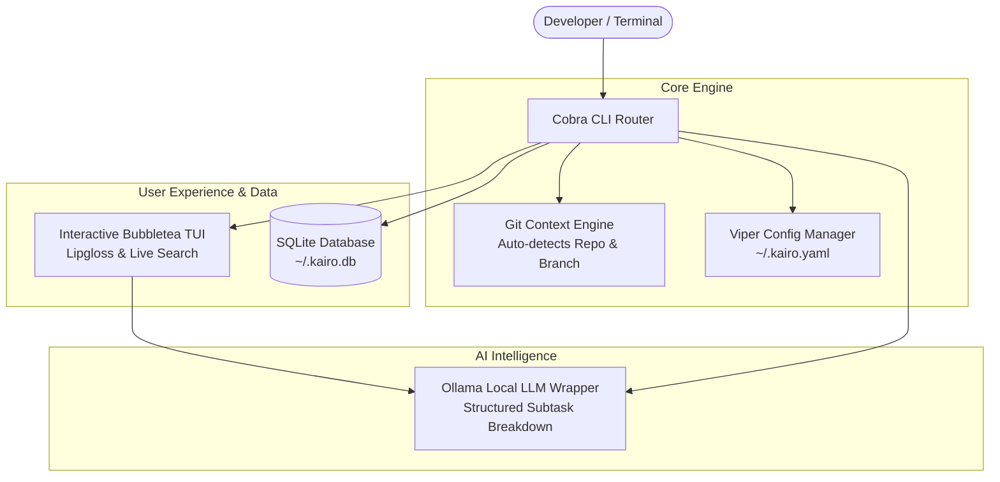

# ⏳ Kairo CLI — Context-Aware Terminal Task & AI Decomposition Engine

> **Kairo** (derived from *Kairos*, meaning the opportune moment) is a high-performance, offline-first terminal task manager built with **Go**, **Cobra**, **Charm (Bubbletea & Lipgloss)**, **SQLite**, and local **Ollama AI**.

---

## 🌟 Key Features

- 🌲 **Git Branch Context Awareness**: Tasks are automatically bound to your active Git repository path and branch name. Switching branches dynamically filters your task list!
- 🎨 **Interactive TUI Dashboard (`kairo ui` / `make ui`)**: Full-screen terminal dashboard with Vim navigation (`j`/`k`), priority badges, real-time search, sorting, inline editing, and status filter tabs.
- 🤖 **Local AI Task Decomposition (`--ai` / `Shift+A`)**: Automatically breaks down complex software tasks into actionable subtasks using local Ollama models (`llama3.2`) with zero external API latency.
- 📊 **Workspace Metrics & Analytics (`kairo stats`)**: Displays visual progress meters, completion percentages, and priority breakdowns.
- 📋 **PR Checklist Markdown Exporter (`kairo export`)**: Export active workspace checklists straight into Markdown for PR descriptions or GitHub issues.
- ⚙️ **Configurable YAML Engine (`~/.kairo.yaml`)**: Manage models, endpoints, and providers via Viper.
- 🚀 **Single-Command Developer Workflow (`Makefile`)**: Fast target macros (`make dev`, `make demo`, `make ui`, `make stats`, `make reset`).

---

## 🏗 System Architecture



---

## 💻 Keybindings Reference (TUI Dashboard)

| Keybinding | Action |
| :--- | :--- |
| `j` / `k` or `↑` / `↓` | Navigate task list |
| `Space` | Toggle task completion (`[x]` DONE) |
| `p` | Cycle Task Priority (`LOW` ➔ `MED` ➔ `HIGH`) |
| `s` | Cycle Task Sort (`Default` ➔ `Priority` ➔ `Due Date`) |
| `a` | Add new task inline |
| `e` | Edit highlighted task title |
| `d` | Delete highlighted task |
| `c` | Clear/Purge all completed tasks |
| `Shift+A` | Run AI Decomposition on highlighted task |
| `Tab` | Switch View Tab (`ALL` ➔ `TODO` ➔ `DONE`) |
| `/` | Live search / filter tasks |
| `?` | Toggle Keybinding Help Modal |
| `q` | Quit dashboard |

---

## 🛠 Single-Command Developer Workflow (`Makefile`)

```bash
# Launch interactive TUI
make ui

# Run fresh dev setup (reset DB, seed demo tasks with priorities/due dates, launch TUI)
make dev

# Display analytics and workspace metrics
make stats

# Run in-memory SQLite unit test suite
make test

# Clear compiled binary and local database
make reset
🛠 Tech Stack
Language: Go (Golang 1.22+)

CLI Framework: Cobra & Viper

Terminal UI: Charm Bubbletea, Lipgloss, Bubbles

Database: Embedded SQLite (mattn/go-sqlite3)

Git Integration: Native Git CLI Wrapper

AI Integration: Ollama Local LLM API Wrapper


---

### Step 3: Test Local Configuration Viewer!

Rebuild and test your new command:

```bash
make build
./kairo config
Output:

⚙️  Kairo System Configuration
--------------------------------------------
 AI Provider:   ollama
 AI Model:      llama3.2
 Ollama URL:    http://localhost:11434
 OpenAI Key:    [NOT SET]
--------------------------------------------
📍 Active Workspace Context
 Git Repo:      /home/rakshabr/projects/kairo-cli
 Git Branch:    main
 Config File:   ~/.kairo.yaml
 SQLite DB:     ~/.kairo.db
--------------------------------------------